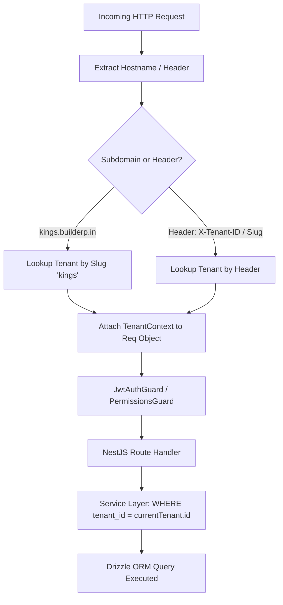
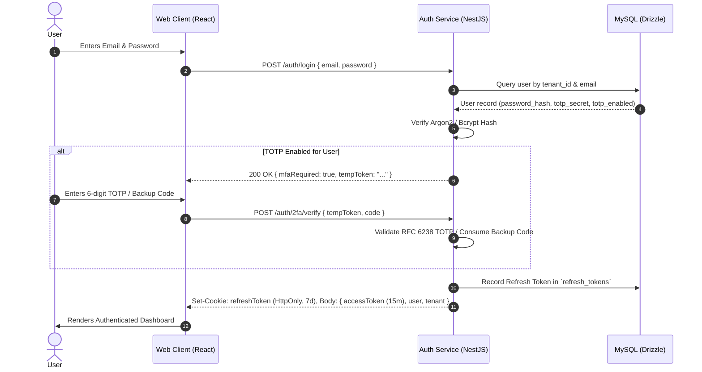
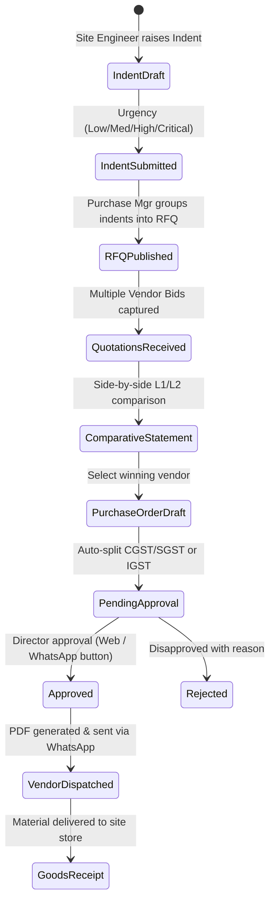
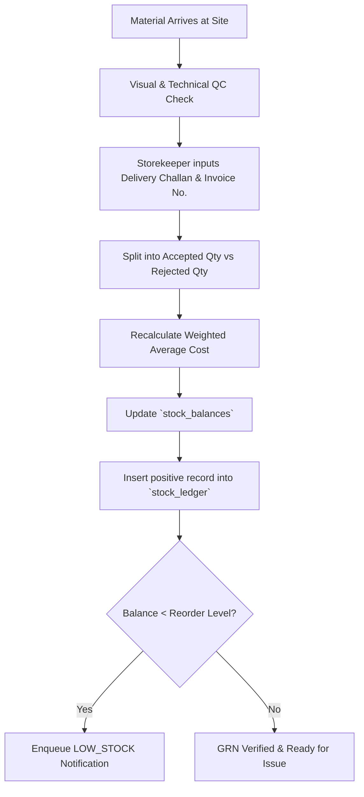
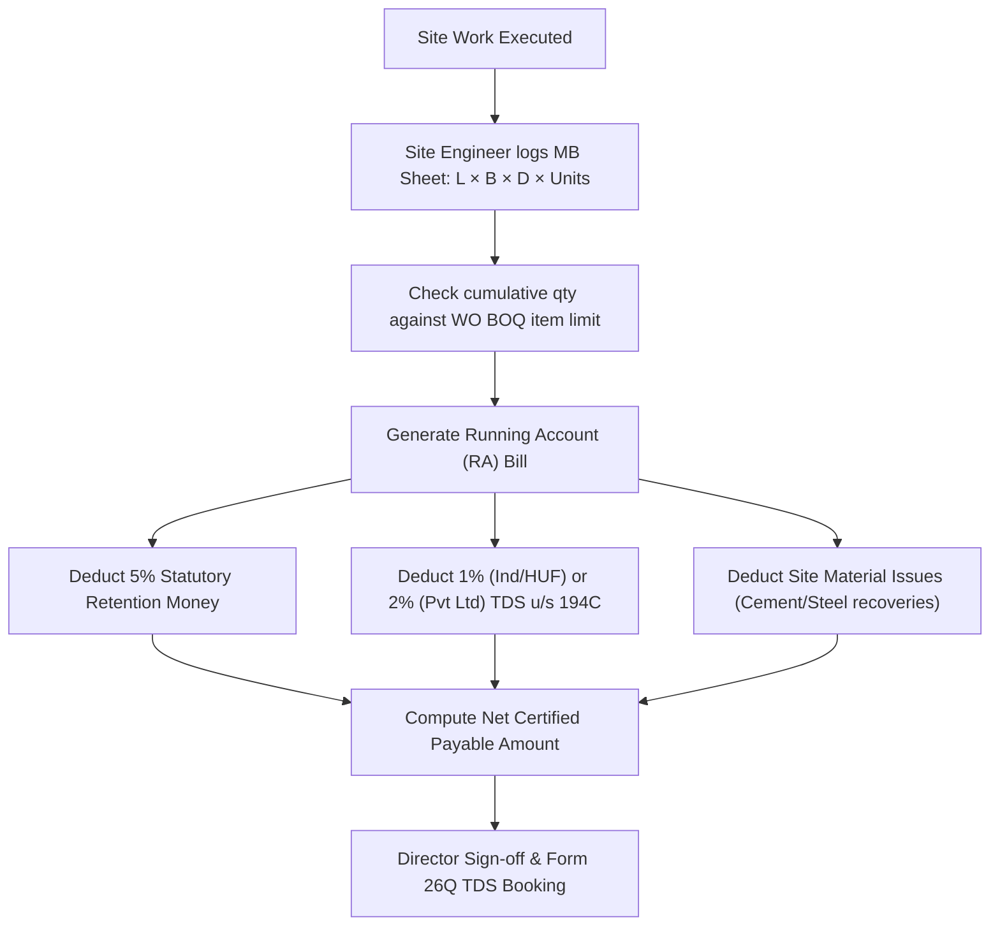
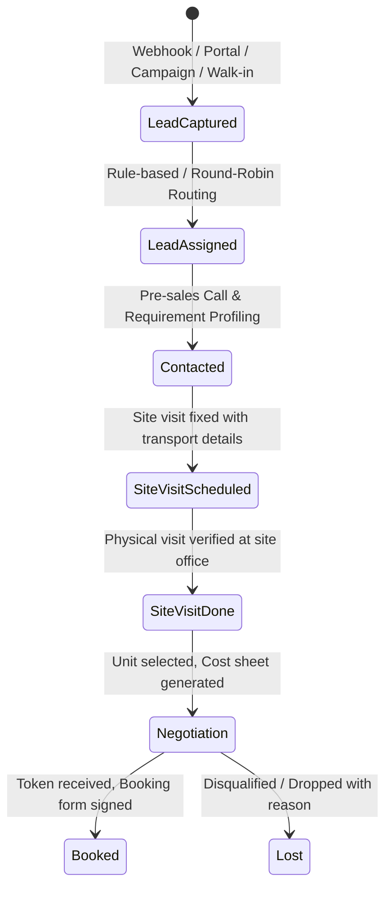
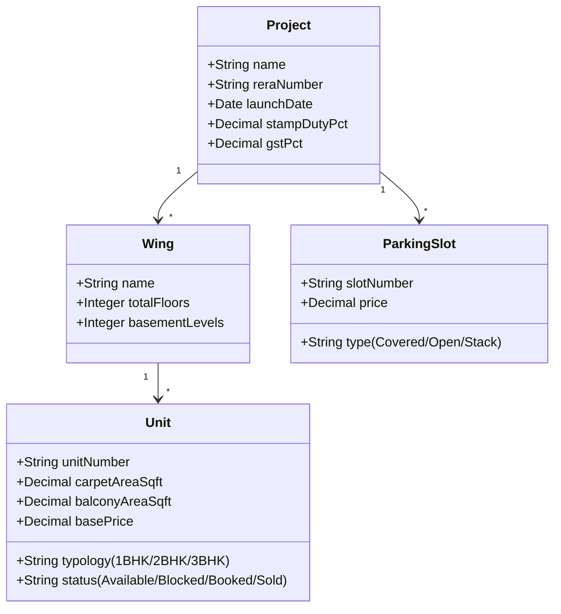
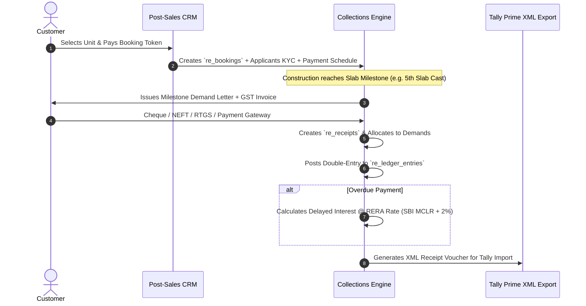
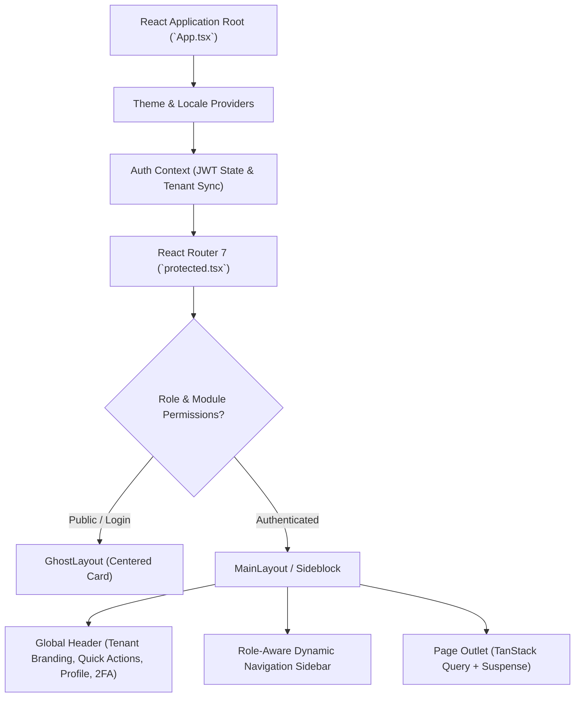

# BuildERP — Comprehensive System Design Document (SDD)

> **Enterprise Multi-Tenant SaaS ERP for Construction, Procurement, Inventory & Realty Sales**  
> **Repository:** `goodsmanagement`  
> **Reference Client Tenant:** Kings Builders & Developers (`kings`)  
> **Statutory Framework:** Indian Tax & Real Estate Mandates (CGST/SGST/IGST, Section 194C TDS, Form 26Q, RERA, Defect Liability Period Reserves)

---

## 1. Executive Summary & Vision

**BuildERP** is an enterprise-grade, multi-tenant Software-as-a-Service (SaaS) ERP purpose-built for the Indian real estate development, EPC contracting, and infrastructure industry. 

Historically, construction firms operate across disconnected silos:
- Site supervisors track site progress, equipment logs, and labour muster rolls on physical registers or WhatsApp groups.
- Procurement teams handle vendor quotes and purchase orders over uncoordinated spreadsheets and emails.
- Storekeepers calculate stock receipts on loose Delivery Challans with untracked moving average pricing.
- Subcontractor billing is plagued by disputes over manual physical Measurement Books (MB Books), statutory tax deductions (TDS Section 194C), and 5% Defect Liability Period (DLP) retention funds.
- Sales and CRM teams work on independent tools (e.g., Sell.Do or Newton Flat Deal), disconnected from construction milestones, cost sheets, and finance ledgers.

BuildERP resolves this by merging **Core Construction Operations** (Procurement, Stores, Contracting, BOQ, Site DPR, Labour) and **Realty Sales & Post-Sales CRM** (Leads, Unit Inventory, Dynamic Cost Sheets, Channel Partners, RERA Demands, Receipts, Customer Ledgers) into a unified, high-performance monorepo platform.

```
┌─────────────────────────────────────────────────────────────────────────────────────────────┐
│                                          BUILDERP                                           │
├──────────────────────────────────────────────┬──────────────────────────────────────────────┤
│           CONSTRUCTION ERP ENGINE            │            REALTY SALES & CRM ENGINE         │
├──────────────────────────────────────────────┼──────────────────────────────────────────────┤
│ • Material Indents & Urgency Tiers           │ • Omni-Channel Lead Capture & Staging        │
│ • Multi-Vendor RFQ Comparative Statements    │ • Auto-Routing Rules & Follow-up Matrix      │
│ • Intra/Inter-state GST Purchase Orders      │ • Phase/Wing/Floor Unit Inventory Grid       │
│ • Store Inward (GRN) with QC Inspections     │ • Dynamic Cost Sheets & Discount Approvals   │
│ • Perpetual Moving Weighted Stock Valuation  │ • RERA Channel Partner Onboarding & Slabs    │
│ • Subcontractor Work Orders & MB Sheets      │ • Multi-Applicant Bookings & KYC Repository  │
│ • Running Account (RA) Bills with 194C TDS   │ • Milestone Demands & Construction Receipts  │
│ • 5% DLP Statutory Retention Money Reserve   │ • Customer Ledgers & Delayed Interest (RERA) │
│ • Mobile DPRs, Equipment & Photo Gallery     │ • Cancellations, Forfeitures & Flat Transfer │
│ • Labour Muster Roll & Skill Headcounts      │ • Template Letter Engine (Allotment, NOC)    │
│ • BOQ Budget vs Actual Variance Engine       │ • Tally Prime XML Receipt Voucher Export     │
└──────────────────────────────────────────────┴──────────────────────────────────────────────┘
```

---

## 2. System Architecture & Tech Stack

BuildERP is engineered as a **Modular Monolith** organized in a Turborepo + pnpm workspace structure.

```
┌───────────────────────────────────────────────────────────────────────────────────────────┐
│                                     PRESENTATION LAYER                                    │
│  React 19 • Vite 7 • Tailux CSS 4 • TanStack Query • TanStack Table • ApexCharts          │
│  Multi-tenant Hostname / Subdomain Switcher (kings.builderp.in / admin.builderp.in)       │
└─────────────────────────────────────────────┬─────────────────────────────────────────────┘
                                              │
                                              │ HTTPS / JSON REST API (Bearer JWT)
                                              ▼
┌───────────────────────────────────────────────────────────────────────────────────────────┐
│                                     APPLICATION LAYER                                     │
│  NestJS 11 (Express) • TypeScript 5.9 • Pino Logger • Throttler Rate Limiter              │
│  Global TenantMiddleware • JwtAuthGuard • PermissionsGuard • ResponseEnvelopeInterceptor │
│  BullMQ Worker Queue / In-Memory Queue • Meta WhatsApp Cloud API • Tally Prime XML Engine│
└─────────────────────────────────────────────┬─────────────────────────────────────────────┘
                                              │
                                              │ Type-Safe SQL (Drizzle ORM via mysql2)
                                              ▼
┌───────────────────────────────────────────────────────────────────────────────────────────┐
│                                      DATA LAYER (MySQL)                                   │
│  MySQL 8.0 / MariaDB 10.4 (InnoDB, utf8mb4_unicode_ci)                                    │
│  Strict Row-Level Partitioning via indexed `tenant_id` across 80+ Tables                  │
│  Foreign Keys with Cascading Rules • Point-in-Time Audit Trail (`audit_logs`)             │
└───────────────────────────────────────────────────────────────────────────────────────────┘
```

### 2.1 Technology Stack Specifications

| Layer | Technology | Version | Rationale & Responsibilities |
|---|---|---|---|
| **Monorepo** | pnpm + Turborepo | 9.x / 2.x | Unified dependency graph, cached cross-package compilation, zero code duplication. |
| **Backend Framework** | NestJS | 11.x | Modular dependency injection, enterprise middleware pipeline, declarative decorators. |
| **Runtime & Language** | Node.js + TypeScript | 22 LTS / 5.9 | Native ESM support, high asynchronous throughput, strict compile-time types. |
| **Database ORM** | Drizzle ORM | 0.40+ | Pure SQL query builder, zero-runtime query bloat, zero-Prisma overhead, native connection pooling via `mysql2`. |
| **Database Engine** | MySQL / MariaDB | 8.0+ / 10.4+ | InnoDB ACID transactions, row-level locking, foreign key integrity, spatial/decimal precision. |
| **Frontend Framework** | React + Vite | 19.x / 7.x | Concurrent rendering, sub-second HMR development loop, tree-shaken production bundles. |
| **UI Design System** | Tailux + Tailwind CSS | v4.x | Enterprise dashboard system, tokenized primary branding (`#c5a04e`), responsive mobile layouts. |
| **State Management** | TanStack Query + Context | v5.x | Automatic caching, background refetching, optimistic updates, decoupled local UI state. |
| **Data Tables** | TanStack Table | v8.x | Headless table engine with sorting, multi-column search, pagination, and virtualization. |
| **Data Visualization** | React-ApexCharts | Latest | Interactive financial, lead funnel, and site consumption trend charts. |
| **Queue & Workers** | BullMQ + In-Memory Fallback | 5.x | Asynchronous background processing (email notifications, WhatsApp dispatches) with graceful degradation. |
| **Security & 2FA** | Argon2 / Otplib / QRCode | Latest | Password hashing, RFC 6238 TOTP two-factor authentication, one-time recovery codes. |
| **Integration** | Meta Cloud API / Tally XML | Latest | Official WhatsApp Business messaging (`v21.0`), standard Tally Prime ERP 9 XML schemas. |

---

## 3. Monorepo Structure

The repository is structured into distinct workspace packages adhering to strict boundaries:

```
goodsmanagement/
├── apps/
│   ├── api/                          # Backend API Application (@builderp/api)
│   │   ├── src/
│   │   │   ├── app.module.ts         # Root NestJS module assembly & middleware wiring
│   │   │   ├── main.ts               # Application entry point, Swagger, CORS, Helmet
│   │   │   ├── auth/                 # Authentication, JWT strategy, TOTP 2FA, guards
│   │   │   ├── common/               # Tenant middleware, interceptors, exception filters
│   │   │   ├── config/               # Environment schema (Zod validated) & loader
│   │   │   ├── database/             # Drizzle connection, migrations, seeds, schemas
│   │   │   │   ├── schema/
│   │   │   │   │   ├── index.ts      # Core construction & system tables (41 tables)
│   │   │   │   │   └── realty.ts     # Realty sales, CRM & post-sales tables (43 tables)
│   │   │   ├── masters/              # Sites, items, categories, vendors, contractors
│   │   │   ├── procurement/          # Material indents, RFQs, vendor quotes, POs
│   │   │   ├── inventory/            # GRN, store inward, stock valuation, material issues
│   │   │   ├── contractors-billing/  # Work orders, MB sheets, RA bills, 194C TDS, DLP
│   │   │   ├── dpr/                  # Daily Progress Reports, work progress, site photos
│   │   │   ├── labour/               # Contractor attendance muster roll & trade matrix
│   │   │   ├── boq/                  # BOQ budget lines vs actual material consumption
│   │   │   ├── integrations/         # Tally Prime XML export for POs and receipts
│   │   │   ├── dashboard/            # Executive KPI aggregations & statutory reports
│   │   │   ├── notifications/        # In-app alerts, BullMQ queue, WhatsApp Cloud API
│   │   │   ├── realty/               # Realty Sales & CRM domain module
│   │   │   │   ├── crm/              # Leads, follow-ups, site visits, routing rules
│   │   │   │   ├── inventory/        # Phases, wings, floors, units, parking, cost sheets
│   │   │   │   ├── channel-partners/ # Brokers, lead protection, tiered slabs, payouts
│   │   │   │   ├── post-sales/       # Bookings, demands, receipts, ledger, cancellations
│   │   │   │   ├── setup/            # RERA project settings, charge heads, pay stages
│   │   │   │   ├── dashboard/        # Sales velocity, aging inventory, collection KPIs
│   │   │   │   └── reports/          # Sales MIS, demand aging, tax & brokerage reports
│   │   │   └── super-admin/          # Tenant provisioning & feature module switches
│   │   └── package.json
│   └── web/                          # Frontend Application (@builderp/web)
│       ├── src/
│       │   ├── app/
│       │   │   ├── contexts/         # AuthContext, ThemeContext, LocaleContext, SidebarContext
│       │   │   ├── layouts/          # MainLayout, Sideblock, DynamicLayout, Root
│       │   │   ├── navigation/       # Segmented navigation trees & role access maps
│       │   │   ├── pages/            # Page controllers & screens
│       │   │   │   ├── Auth/         # Login, 2FA verify/setup, recovery
│       │   │   │   ├── procurement/  # Indents, RFQs, POs, Approvals
│       │   │   │   ├── inventory/    # GRN, stock ledger, store issues, warehouse balances
│       │   │   │   ├── contractors/  # Work orders, MB sheets, RA bills, retainage
│       │   │   │   ├── site-operations/# Mobile DPR, labour attendance, BOQ tracking
│       │   │   │   ├── masters/      # Items, vendors, contractors, sites, categories
│       │   │   │   ├── realty/       # Leads, units, cost sheets, bookings, demands, receipts
│       │   │   │   ├── cp-portal/    # Broker self-service view, lead tagging, brokerage claims
│       │   │   │   ├── dashboards/   # Role-specific executive, project & sales dashboards
│       │   │   │   └── super-admin/  # Tenant management, module toggles
│       │   │   └── router/           # React Router 7 route definitions (Public, Ghost, Protected)
│       │   ├── components/           # Tailux primitives, TableSkeleton, EmptyState, ConfirmModal
│       │   ├── lib/                  # Axios api-client with auth token interceptors
│       │   ├── styles/               # CSS variables, Tailux theme tokens, dark mode
│       │   └── utils/                # Number formatting (Lakhs/Crores), GST math, dates
│       └── package.json
├── packages/
│   ├── shared/                       # Shared Domain Package (@builderp/shared)
│   │   ├── src/
│   │   │   ├── constants/            # Application constants, tax defaults, pagination
│   │   │   ├── enums/                # Document statuses, lead stages, payment modes
│   │   │   ├── gst/                  # Indian GST calculation engine & state code matrix
│   │   │   ├── permissions/          # Granular RBAC permission keys (120+ permissions)
│   │   │   ├── types/                # Core domain TypeScript models & API envelopes
│   │   │   └── zod/                  # Cross-platform validation schemas
│   │   └── package.json
│   └── config/                       # Shared Tooling Configs (@builderp/config)
│       ├── eslint/
│       ├── prettier/
│       └── typescript/
├── docker/                           # Container Infrastructure (MySQL, Redis, MinIO, Mailpit)
├── docs/                             # Reference documentation (ARCHITECTURE, API, TENANCY, RUNBOOK)
├── scripts/                          # Automated MySQL backup scripts (.ps1 and .sh)
├── pnpm-workspace.yaml
├── turbo.json
└── package.json
```

---

## 4. Multi-Tenancy & Security Architecture

### 4.1 Tenancy Strategy: Logical Shared Database with Row Isolation

BuildERP employs a **Shared Database, Shared Schema** architectural pattern.
- **Tenant Isolation:** Every table in the schema (except `tenants` and `tenant_modules`) includes a non-nullable foreign key column:
  ```sql
  tenant_id BIGINT UNSIGNED NOT NULL REFERENCES tenants(id) ON DELETE CASCADE
  ```
- **Composite Indexing:** High-traffic querying is indexed with `(tenant_id, ...)` prefix to enforce index scans strictly within the tenant's partition.
- **Unique Scoping:** Unique constraints are scoped per tenant (e.g., `UNIQUE(tenant_id, code)` or `UNIQUE(tenant_id, document_number)`).



### 4.2 Tenant Lifecycle Middleware

```typescript
// Resolution pipeline executed on every incoming HTTP call:
1. Extract tenant slug from subdomain (e.g. "kings" from "kings.builderp.in")
   OR extract from 'x-tenant-id' / 'x-tenant-slug' header.
2. Query cached tenant record in `tenants` table.
3. If inactive or missing -> reject with 403 Forbidden ("Tenant not found or suspended").
4. Bind `req.tenant` with { id, uuid, slug, name, primaryColor, gstin, stateCode }.
5. Inject via `@CurrentTenant()` parameter decorator in NestJS controllers.
```

### 4.3 Role-Based Access Control (RBAC)

The platform provides a fine-grained, string-keyed permission matrix (`<module>.<action>`):
- **Super Administrator (`super_admin`):** Cross-tenant SaaS operations, tenant provisioning, feature module activation.
- **Company Director / Owner (`boss`):** Wildcard permission bypass (`*`). Full access across procurement, store valuation, contract approvals, financials, and realty.
- **General Administrator (`admin`):** Full tenant administration, user management, master data control.
- **Purchase Manager (`purchase`):** Indents, RFQ generation, quotation comparison, PO creation.
- **Storekeeper (`store`):** Goods Receipt Notes (GRN), visual QC inspection, store issues, physical stock audits.
- **Site Engineer (`sitemgr`):** Indents, Daily Progress Reports (DPR), Labour muster rolls, Measurement Book (MB Sheet) entries.
- **Sales Head (`saleshead`):** Lead distribution, pricing approvals, discount overrides, team pipeline tracking.
- **Sales Executive (`salesexec`):** Lead follow-ups, site visit logging, cost sheet configuration, booking creation.
- **CRM / Post-Sales Executive (`crm`):** Document verification, applicant KYC, payment milestones, NOC/Allotment letters.
- **Collections Accountant (`collections`):** Demand letters, payment receipts, customer ledgers, delayed payment interest, Tally exports.
- **Channel Partner (`cp_demo`):** Dedicated external broker view for lead tagging, client site-visit status, and brokerage claims.

### 4.4 Zero-Trust Authentication & 2FA Pipeline



---

## 5. Domain Subsystems & Business Workflows

### 5.1 Subsystem 1: Construction Procurement Engine

The procurement engine automates material sourcing from site requisitions to signed vendor orders.



#### GST Calculation Engine Specifications
The procurement and post-sales subsystems incorporate an automated tax engine:
- **Intra-State Supply (Supplier State Code == Site State Code):**
  $$\text{CGST} = \text{Taxable Amount} \times \frac{\text{Rate}}{2}, \quad \text{SGST} = \text{Taxable Amount} \times \frac{\text{Rate}}{2}$$
- **Inter-State Supply (Supplier State Code} \neq \text{Site State Code):**
  $$\text{IGST} = \text{Taxable Amount} \times \text{Rate}$$
- **Exempt / Reverse Charge:** Automatic detection based on HSN/SAC codes.

---

### 5.2 Subsystem 2: Store Inward & Perpetual Moving Weighted Stock Valuation

When physical materials arrive on site, the storekeeper records a Goods Receipt Note (GRN):



#### Moving Weighted Average Rate Formula
Every store inward receipt updates the item's moving weighted average rate:
$$\bar{R}_{\text{new}} = \frac{(Q_{\text{current}} \times R_{\text{current}}) + (Q_{\text{accepted}} \times R_{\text{PO}})}{Q_{\text{current}} + Q_{\text{accepted}}}$$

When goods are issued to trade contractors for execution, the issue cost is valued at $\bar{R}_{\text{new}}$, generating a corresponding debit against the site work order and crediting site warehouse inventory.

---

### 5.3 Subsystem 3: Subcontractor Billing & Statutory Withholdings

Subcontractor contracts (RCC, masonry, plumbing, electrical, tiling) are administered via Work Orders (WOs) based on physical verification recorded in the **Measurement Book (MB Sheet)**.



#### Deductions & Statutory Liabilities
1. **Section 194C TDS Withholding:**
   - 1.0% for Individual / Sole Proprietor / HUF contractors.
   - 2.0% for Corporate / Partnership / LLP contractors.
   - Auto-accumulated for quarterly Form 26Q tax reporting.
2. **5% Retention Money (Defect Liability Period - DLP):**
   - 5.0% withheld from each gross RA bill.
   - Placed in a statutory retention reserve liability account for 6 to 12 months post practical completion. Released only upon issuance of Final Completion Certificate.

---

### 5.4 Subsystem 4: Site Operations, DPR & Labour Tracking

1. **Daily Progress Reports (DPR):**
   - Shift tracking (Day / Night), temperature, and weather conditions (Clear, Sunny, Rain, Overcast).
   - Activity progress tracking against planned quantities (e.g., $M30$ Concreting, Fe550D Steel Binding, AAC Block Masonry).
   - Heavy machinery utilization logs: Running hours, Idle hours, Breakdown hours (e.g., Tower Crane, Putzmeister Concrete Pump).
   - Time-stamped, geo-referenced photo attachments for QA/QC inspections.
2. **Contractor Labour Muster Roll:**
   - Touch-friendly headcount attendance matrix recording deployed labour classified by trade (Carpentry, Steel, Masonry, Plumbing, Electrical).
   - Categorization by skill level: Skilled, Semi-Skilled, Unskilled, Female Labour, Supervisors, and Overtime Hours.

---

### 5.5 Subsystem 5: BOQ & Consumption Budget Control

- Establishes project baseline quantities and material standards derived from architectural and structural drawings.
- Compares real-time physical store issues against standard consumption estimates:
  - **Normal Status:** Variance $\le 2\%$.
  - **Caution Status:** Variance between $2\%$ and $5\%$.
  - **Breached Status:** Variance $> 5\%$, triggering automated executive audit alerts to prevent on-site material pilferage or structural over-consumption.

---

### 5.6 Subsystem 6: Realty Marketing & Pre-Sales CRM

The Realty engine integrates direct sales, online lead generation, and walk-in management:



- **Anti-Poaching Protection:** Phone and email deduplication rules prevent duplicate broker submissions.
- **Activity Timeline:** Complete chronological ledger of calls, WhatsApp messages, site visits, and status transitions.

---

### 5.7 Subsystem 7: Real Estate Inventory & Dynamic Cost Sheets

Spatial hierarchy is organized to mirror real-world real estate configurations:

$$\text{Project (Site)} \longrightarrow \text{Phase} \longrightarrow \text{Wing / Tower} \longrightarrow \text{Floor} \longrightarrow \text{Unit / Flat}$$



#### Dynamic Cost Sheet Calculation Engine
A customer cost sheet aggregates tiered components into an all-inclusive property valuation:
1. **Basic Agreement Value:** Carpet Area $\times$ Base Rate per Sq. Ft. + Floor Rise + Premium Location Charges (PLC).
2. **Other Development Charges:** Infrastructure, Club House, Legal & Documentation, MSEB & Water Connection, Gas Pipeline.
3. **Statutory Taxes & Duties:**
   - GST (1% for Affordable Housing $\le 45$ Lakhs and $\le 60$ sqm metro / $90$ sqm non-metro; 5% for Standard Residential).
   - Stamp Duty (e.g., 5% to 7% based on state jurisdiction) + Registration Fee.
4. **Maintenance & Deposits:** 12/24 months advance maintenance, Society Formation, Municipal Tax Deposits, Sinking/Corpus Fund.

---

### 5.8 Subsystem 8: Channel Partner (Broker) Ecosystem

- **RERA Compliance:** Broker onboarding enforces verification of Maharashtra Real Estate Regulatory Authority (MahaRERA) registration certificates.
- **Lead Protection Window:** Leads tagged to a Channel Partner are strictly protected for 60 to 90 days. If the lead books within this window, brokerage is credited automatically to that partner.
- **Tiered Brokerage Slabs:** Configurable commission curves (e.g., 2% standard, 2.5% for 3+ bookings, 3% for 5+ bookings in a quarter).
- **Brokerage Accrual & Payout:** Commissions accrue upon clearance of $10\%$ agreement value + registration, with automatic TDS Section 194H ($5\%$) deduction on payout vouchers.

---

### 5.9 Subsystem 9: Post-Sales, Demands & Customer Collections



#### Automated Delayed Payment Interest
In compliance with RERA statutes, unpaid milestone demands attract interest:
$$\text{Interest} = \text{Overdue Principal} \times \frac{\text{SBI Highest MCLR} + 2\%}{365} \times \text{Days Overdue}$$

---

### 5.10 Subsystem 10: Integrations & Communications

1. **Tally Prime / ERP 9 XML Export:**
   - Double-entry accounting synchronization without requiring third-party middleware.
   - Generates Tally-compliant `<ENVELOPE>` XML containing `<VOUCHER>` elements for:
     - **Purchase Vouchers:** Crediting Vendor Ledger, Debiting Material Expenses, Debiting CGST/SGST/IGST Input Tax Ledgers.
     - **Receipt Vouchers:** Debiting Bank / Cheque-in-Hand, Crediting Customer Advance / Receivable Ledgers, Crediting Output GST Ledgers.
2. **Meta WhatsApp Business Cloud API (`graph.facebook.com/v21.0`):**
   - Asynchronous notification engine with interactive quick-reply approval actions for Directors (`[Approve PO]`, `[Reject]`).
   - Automated PDF document delivery (Purchase Orders to suppliers, Demand Letters and Receipts to homebuyers).
   - Graceful stub provider fallback during local development.
3. **BullMQ Worker Queue:**
   - Redis-backed distributed task queue with transparent in-memory fallback for local environments without Redis.

---

## 6. Complete Database Schema (84 Tables)

All tables use `InnoDB`, `utf8mb4_unicode_ci`, `BIGINT UNSIGNED AUTO_INCREMENT` primary keys, standard UUIDs, and strict `tenant_id` partitioning.

### 6.1 Core System & Construction Schema (`apps/api/src/database/schema/index.ts`)

| # | Table Name | Purpose & Domain |
|---|---|---|
| 1 | `tenants` | Multi-tenant accounts, company profile, GSTIN, primary branding color, subscription state. |
| 2 | `roles` | System and tenant-defined RBAC roles (`boss`, `admin`, `purchase`, `store`, `sitemgr`). |
| 3 | `permissions` | Universal permission dictionary (`<module>.<action>`). |
| 4 | `role_permissions` | Many-to-many relationship mapping roles to specific permissions. |
| 5 | `users` | User credentials, contact info, role references, TOTP 2FA secret, recovery codes. |
| 6 | `user_sites` | Site-level access scoping restricting engineers and storekeepers to assigned projects. |
| 7 | `refresh_tokens` | Hashed refresh tokens with device fingerprinting and automatic rotation. |
| 8 | `audit_logs` | Immutable audit trail capturing JSON diff snapshots (`before_state`, `after_state`) for all mutations. |
| 9 | `categories` | Material classification hierarchy (Cement, Steel, Aggregates, Plumbing, Electrical). |
| 10 | `units` | Physical units of measure (BAG, MT, KG, LTR, PCS, SQFT, RFT, BRASS). |
| 11 | `items` | Master item catalog: SKU code, HSN code, GST rate, standard purchase rate, reorder level. |
| 12 | `sites` | Physical construction projects / real-estate developments: location, state code, RERA details. |
| 13 | `warehouses` | Storage locations and site yards within a project. |
| 14 | `vendors` | Supplier master: GSTIN, PAN, MSME registration, bank details, state code. |
| 15 | `contractors` | Labor & trade contractor master: PAN, Section 194C classification, bank details. |
| 16 | `document_series` | Financial-year auto-numbering series (`KB/PO/26-27/0001`, `KB/GRN/26-27/0001`). |
| 17 | `material_indents` | Requisitions raised from sites with urgency indicators (Low, Med, High, Critical). |
| 18 | `indent_items` | Individual line items and required-by dates attached to an indent. |
| 19 | `rfqs` | Request for Quotation dossiers sent out to suppliers. |
| 20 | `rfq_items` | Material line items included in an RFQ. |
| 21 | `rfq_quotations` | Commercial bids and quotation submissions received from vendors. |
| 22 | `rfq_quotation_items` | Itemized quoted rates, freight charges, and promised delivery lead times. |
| 23 | `purchase_orders` | Legal purchase contracts: vendor, delivery warehouse, GST split, net amount, approval state. |
| 24 | `po_items` | PO line items: ordered quantity, unit price, discount, HSN, CGST, SGST, IGST. |
| 25 | `goods_receipt_notes` | Store inward notes: delivery challan, vendor invoice, QC inspection sign-off. |
| 26 | `grn_items` | Received, accepted, and rejected quantities, QC rejection reasons. |
| 27 | `stock_ledger` | Double-entry inventory movement ledger tracking every inbound, outbound, and adjustment event. |
| 28 | `stock_balances` | Real-time warehouse on-hand balances with moving weighted-average valuation. |
| 29 | `material_issues` | Issues of materials from site store to contractors for specific work orders. |
| 30 | `material_issue_items`| Quantities and weighted-average valuation of materials issued. |
| 31 | `work_orders` | Subcontract work orders: contractor, scope of work, BOQ rate contracts, DLP duration. |
| 32 | `wo_items` | Detailed line items of work order: description, unit of measurement, rate, estimated quantity. |
| 33 | `ra_bills` | Running Account bills: gross certified value, 5% DLP retention, Section 194C TDS, net payable. |
| 34 | `measurement_sheets`| Physical Measurement Book (MB Book) records: $L \times B \times D \times \text{Units}$. |
| 35 | `notifications` | In-app alerts, read states, BullMQ queue dispatch tracking. |
| 36 | `daily_progress_reports`| Daily site diary: weather, temperature, working shift, work summary, safety incidents. |
| 37 | `dpr_work_items` | Milestone and activity completion quantities logged on a given date. |
| 38 | `dpr_photos` | Progress photographs tagged by site location and activity. |
| 39 | `dpr_equipments` | Heavy machinery utilization log: running, idle, and breakdown hours. |
| 40 | `labour_attendance` | Contractor muster roll: skilled, semi-skilled, unskilled headcounts and overtime. |
| 41 | `boq_items` | Baseline project BOQ material quantities vs actual store consumption metrics. |

---

### 6.2 Realty Sales, CRM & Post-Sales Schema (`apps/api/src/database/schema/realty.ts`)

| # | Table Name | Purpose & Domain |
|---|---|---|
| 42 | `tenant_modules` | Feature gating per tenant (e.g., `realty_sales` enabled/disabled). |
| 43 | `re_project_settings`| Real estate extensions for a site: RERA ID, launch date, possession date, stamp duty %, GST %. |
| 44 | `re_phases` | Project construction phases (e.g., Phase 1, Phase 2). |
| 45 | `re_wings` | Towers / Wings within a phase (e.g., Wing A, Wing B). |
| 46 | `re_floors` | Floor levels within a wing (e.g., Ground, 1st to 24th Floor, Refuge). |
| 47 | `re_unit_types` | Architectural typologies (1 BHK, 2 BHK Luxury, 3 BHK Penthouse) and areas. |
| 48 | `re_units` | Inventory of individual flats: carpet area, balcony area, base price, inventory status. |
| 49 | `re_parking_slots` | Stilt, open, stack, and basement vehicle parking inventory. |
| 50 | `re_charge_heads` | Component pricing rules: Development, Clubhouse, Legal, Corpus Fund, Advance Maintenance. |
| 51 | `re_pay_stages` | Standard construction milestone definitions (Plinth, 1st Slab, Brickwork, Flooring, Possession). |
| 52 | `re_schemes` | Commercial payment schemes (Construction-Linked Plan, Down Payment Plan, Subvention 10:90). |
| 53 | `re_scheme_stages` | Linkage of milestone payment percentages to specific payment schemes. |
| 54 | `re_lead_sources` | Acquisition channels: 99acres, MagicBricks, Google Ads, Hoardings, Walk-ins, Broker. |
| 55 | `re_campaigns` | Marketing campaigns, UTM parameters, budgets, acquisition ROI tracking. |
| 56 | `re_leads` | Customer prospect profiles, budget bracket, lead score, pipeline status. |
| 57 | `re_lead_activities`| Chronological communication audit: calls, emails, notes, status changes. |
| 58 | `re_followups` | Scheduled reminders, overdue alerts, action notes for sales executives. |
| 59 | `re_site_visits` | Physical and virtual site visit logs: cab pickup details, attendees, feedback ratings. |
| 60 | `re_routing_rules` | Automated lead distribution engines: round-robin, project-based, source-based. |
| 61 | `re_cost_sheets` | Formal quotes issued to prospects: itemized charges, taxes, payment schedule simulation. |
| 62 | `re_approvals` | Management approval requests for rate discounts, waiver of charges, or payment milestone shifts. |
| 63 | `re_bookings` | Executed flat purchase contracts: unit reference, scheme, total package value, booking status. |
| 64 | `re_booking_applicants`| Primary applicant and co-applicants: PAN, Aadhaar, address, relationship, KYC documents. |
| 65 | `re_booking_documents` | File repository for signed agreements, payment counterfoils, PAN cards, loan sanction letters. |
| 66 | `re_booking_charges` | Snapshot of agreed charge head amounts applied to a specific booking. |
| 67 | `re_booking_parkings`| Parking slots allocated and locked to a booking. |
| 68 | `re_payment_schedule`| Agreed milestone payment schedule with due dates, percentages, and amounts. |
| 69 | `re_demands` | Milestone demand notices issued to customer: principal due, GST liability, due date. |
| 70 | `re_receipts` | Payment collections: payment mode (Cheque, NEFT, RTGS, UPI), instrument number, clearance status. |
| 71 | `re_receipt_allocations`| Allocation of a single payment across demands, taxes, and delayed interest. |
| 72 | `re_ledger_entries`| Double-entry customer accounting ledger tracking debits, credits, and rolling balances. |
| 73 | `re_interest_entries`| Delayed payment interest charges debited against overdue accounts. |
| 74 | `re_credit_notes` | Adjustments, goodwill waivers, or compensation credits issued to a booking. |
| 75 | `re_cancellations` | Formal booking cancellation dossier: reason, gross paid, statutory deductions, refund schedule. |
| 76 | `re_transfers` | Flat ownership transfer workflow: NOC, transfer fees, replacement applicant records. |
| 77 | `re_letter_templates`| Dynamic Markdown/HTML templates: Allotment Letter, Welcome Letter, Demand Notice, NOC for Bank Loan. |
| 78 | `re_letters_issued` | Archive of rendered and signed letters delivered to customers. |
| 79 | `re_channel_partners`| Broker profiles: RERA registration number, brokerage agreement, bank details. |
| 80 | `re_cp_project_access`| Permissions authorizing specific channel partners to sell designated projects. |
| 81 | `re_cp_lead_tags` | Lead tagging records enforcing the 60/90-day broker anti-poaching protection window. |
| 82 | `re_brokerage_slabs` | Tiered commission structure linked to aggregate booking volume or revenue. |
| 83 | `re_brokerage_entries`| Brokerage accruals and earned commissions linked to specific bookings. |
| 84 | `re_cp_payouts` | Commission disbursement records with TDS Section 194H withholding (5%). |

---

## 7. Frontend Architecture & Design System

The frontend application (`@builderp/web`) is built on **React 19**, **Vite 7**, and **Tailux** (Tailwind CSS v4).

### 7.1 Layout Architecture & Routing Pipeline



### 7.2 UI Design System & Theming Tokens

- **Dynamic Theme Palette:** CSS custom properties driven by tenant configuration.
  ```css
  :root {
    --primary: 197 160 78;        /* Kings Gold: #c5a04e */
    --primary-focus: 175 140 60;
    --primary-content: 255 255 255;
    --radius-box: 0.75rem;
  }
  ```
- **Dark Mode Support:** Automatic switching via `ThemeContext`, persisting preferences in local storage.
- **Enterprise UI Components:**
  - `EmptyState`: Standardized empty vector illustrations for 0-record views.
  - `TableSkeleton`: Shimmering skeleton loaders during TanStack Query caching cycles.
  - `ConfirmModal`: Destructive action guards for approvals, deletions, and cancellations.
  - `sonner`: High-performance toast notification stack.

---

## 8. API Design & Integration Contracts

All endpoints conform to a standardized JSON response envelope.

### 8.1 Unified Response Envelope Contract

```typescript
// Success Envelope
{
  "success": true,
  "data": T | T[],
  "meta"?: {
    "page": number,
    "limit": number,
    "total": number,
    "totalPages": number
  }
}

// Error Envelope
{
  "success": false,
  "statusCode": number,
  "error": string,
  "message": string | string[],
  "timestamp": string
}
```

### 8.2 Primary Route Taxonomies

| Base Route Prefix | Module / Subsystem | Key Operations |
|---|---|---|
| `/api/v1/auth` | Authentication & Security | `POST /login`, `POST /refresh`, `POST /2fa/setup`, `POST /2fa/verify`, `GET /me` |
| `/api/v1/masters` | Common Masters | `GET/POST /items`, `/categories`, `/sites`, `/vendors`, `/contractors` |
| `/api/v1/procurement` | Procurement & Orders | `GET/POST /indents`, `/rfqs`, `/purchase-orders`, `POST /purchase-orders/:id/approve` |
| `/api/v1/inventory` | Stores & Stock | `GET/POST /grn`, `/stock-ledger`, `/stock-balances`, `/material-issues` |
| `/api/v1/contractors-billing` | Contracts & RA Bills | `GET/POST /work-orders`, `/measurement-sheets`, `/ra-bills`, `POST /ra-bills/:id/certify`|
| `/api/v1/dpr` | Daily Progress Reports | `GET/POST /reports`, `POST /reports/:id/photos`, `POST /reports/:id/equipments` |
| `/api/v1/labour` | Labour Muster Roll | `GET/POST /attendance`, `/attendance/matrix` |
| `/api/v1/boq` | BOQ Budget Tracking | `GET /comparison`, `POST /items` |
| `/api/v1/realty/crm` | Pre-Sales CRM | `GET/POST /leads`, `/followups`, `/site-visits`, `POST /leads/assign` |
| `/api/v1/realty/inventory` | Realty Inventory | `GET /grid`, `POST /units`, `POST /cost-sheets/calculate` |
| `/api/v1/realty/post-sales` | Post-Sales & Demands | `GET/POST /bookings`, `/demands`, `/receipts`, `/ledger`, `/cancellations` |
| `/api/v1/realty/channel-partners` | Channel Partners | `GET/POST /brokers`, `/tags`, `/brokerage`, `/payouts` |
| `/api/v1/integrations/tally` | Tally XML Export | `GET /export/purchase-vouchers`, `GET /export/receipt-vouchers` |
| `/api/v1/dashboard` | Analytics & Reports | `GET /executive`, `/procurement`, `/stock-aging`, `/realty-sales` |

---

## 9. Deployment, DevOps & Operational Runbook

### 9.1 Local Development Environment

```bash
# 1. Start local MySQL (port 3307)
# 2. Install workspace dependencies
pnpm install

# 3. Apply Drizzle database schema & seeds
cd apps/api
pnpm db:push
pnpm seed          # Seeds Kings Builders, users, masters, construction data
pnpm seed:realty   # Seeds Realty CRM, inventory, leads, bookings, demands

# 4. Run full application stack (API + Web)
cd ../..
pnpm dev
```

### 9.2 Docker Local Topology (`docker/docker-compose.yml`)

```yaml
services:
  mysql:
    image: mysql:8.0
    ports: ["3307:3306"]
    environment:
      MYSQL_ROOT_PASSWORD: root
      MYSQL_DATABASE: builderp
  redis:
    image: redis:7-alpine
    ports: ["6379:6379"]
  minio:
    image: minio/minio
    ports: ["9000:9000", "9001:9001"]
  mailpit:
    image: axllent/mailpit
    ports: ["8025:8025", "1025:1025"]
```

### 9.3 Automated Database Backup Automation

- **PowerShell Backup Script (`scripts/backup_mysql.ps1`):** Daily snapshot with timestamp naming, compression, and 30-day retention pruning.
- **Bash Backup Script (`scripts/backup_mysql.sh`):** Linux cron job compatible backup script.

---

## 10. Architectural Decisions Log (ADR)

| Decision Reference | Chosen Solution | Alternative Considered | Rationale |
|---|---|---|---|
| **ADR-001: ORM Engine** | **Drizzle ORM** | Prisma ORM | Prisma's Rust query engine binary causes substantial memory overhead in small VMs and lacks full control over high-throughput raw SQL joins. Drizzle generates pure TypeScript SQL builders with zero engine overhead and sub-30ms execution. |
| **ADR-002: Multi-Tenancy** | **Shared DB + Row Isolation** | Database-per-tenant | Database-per-tenant creates operational migration friction when scaling to hundreds of construction clients. Row-level partitioning via indexed `tenant_id` combined with strict NestJS middleware provides proven, cost-effective tenant isolation. |
| **ADR-003: Realty Extension** | **Unified Core Monorepo** | Independent Microservice | Construction and Real Estate Sales are two halves of the same enterprise. Unifying them in one monorepo allows site projects (`sites`) to share master cost codes, bank accounts, and document series without complex distributed transaction sagas. |
| **ADR-004: UI Architecture** | **Tailux (Tailwind 4) TS Starter** | Mantine / Ant Design | Tailux provides purpose-built enterprise dashboard components with native Tailwind CSS tokens, ensuring full control over mobile site DPR layouts and high-density financial data tables. |
| **ADR-005: Accounting Sync** | **Direct Tally Prime XML Export** | Third-Party Sync API | Indian construction builders rely almost exclusively on Tally Prime / ERP 9. Direct generation of schema-valid XML voucher batches allows one-click import into Tally without recurring third-party API subscription costs. |

---

*This document is the authoritative design reference for BuildERP across all development phases.*
