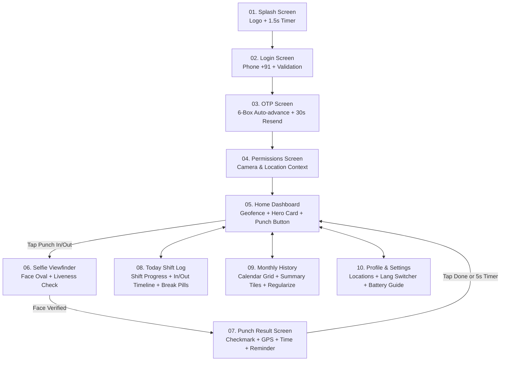

# TrueShift — Design System & UI/UX Specification

> **Version:** 1.0.0  
> **Platform:** Flutter (Android & Cross-Platform)  
> **Design Framework:** Material Design 3 (M3)  
> **Target Devices:** Budget to Mid-Range Android (e.g., Samsung Galaxy M-series, Redmi, Vivo, Oppo)  
> **Target Audience:** Construction Site Engineers, Supervisors, Office Accounts/HR Staff in India  

---

## 1. Executive Summary & Product Context

### 1.1 Brand Identity
* **App Name:** TrueShift
* **Tagline:** Real hours. Real shifts.
* **Core Value:** Live selfie verification coupled with precision geofenced GPS boundaries to ensure tamper-proof, transparent work-shift attendance for construction enterprises.

### 1.2 User Personas & Work Modes

| Persona | Roles | Work Constraints | Geofence Rule |
| :--- | :--- | :--- | :--- |
| **Site Employee** | Site engineers, safety supervisors, quality inspectors | Harsh outdoor sun, dust, cheap phones, gloves, fluctuating 2G/4G connectivity | Locked to assigned construction site radius ($100\,\text{m}$–$250\,\text{m}$). Supports multi-site selection. |
| **Office Employee** | Accounts, HR, estimators, admin personnel | Indoor office, desktop proximity, stable WiFi/4G | Locked to designated corporate office geofence ($50\,\text{m}$–$100\,\text{m}$). |

### 1.3 Core Shift & Attendance Business Rules
* **Standard Shift:** 09:00 AM – 06:00 PM (9 hours total = 8 hours worked + 1 hour unpaid break).
* **Attendance Classifications:**
  * **Present (Full Day):** Cumulative worked duration $\ge 8\,\text{h}$.
  * **Half Day:** Cumulative worked duration between $4\,\text{h} 00\,\text{m}$ and $7\,\text{h} 59\,\text{m}$.
  * **Absent:** Cumulative worked duration $< 4\,\text{h} 00\,\text{m}$.
* **Shift Grace Period:** 15 minutes (marked **Late** if first Punch In is after 09:15 AM).
* **Multiple Punches:** Staff may punch out and in repeatedly across the day (e.g. lunch breaks, client site visits). All intervals are auto-calculated into working sessions and break periods.

---

## 2. Design Philosophy & Principles

### 2.1 Harsh Sunlight & Outdoor Readability
Construction supervisors frequently operate under direct midday sun ($100,000\,\text{lux}$). The UI adheres to **WCAG AAA** contrast standards ($\ge 4.5:1$ for body text, $\ge 3:1$ for UI controls):
* Avoid low-contrast grey-on-white text.
* Deep navy (`#17365D`) and jet black (`#111827`) body text on pure white or crisp light grey surfaces (`#F6F7F9`).
* High-visibility signal colors: Safety Amber (`#F5A524`) for action buttons, Emerald Green (`#157F3D`) for verified states, and Crimson Red (`#B42318`) for alerts.

### 2.2 Budget Android & Heavy Font Scale Responsiveness
Construction site workers routinely configure their phones with enlarged text sizes ($1.3\times$ scale) on compact screens ($360\,\text{dp} \times 800\,\text{dp}$):
* No fixed-height text containers.
* Fluid auto-wrapping (`Wrap`, `Flexible`, `Expanded`, `FittedBox`) across all tabular rows, chips, and metrics.
* Guaranteed **zero RenderFlex overflows** under $1.3\times$ text scaling.

### 2.3 Construction-Grade Touch Targets
Workers on site frequently wear safety gloves or have dusty hands:
* **Minimum Touch Target:** $48\,\text{dp} \times 48\,\text{dp}$.
* **Primary Punch Action Button:** Large $60\,\text{dp}$ height hero button spanning full width.
* Generous padding between interactive elements ($\ge 12\,\text{dp}$).

### 2.4 Tabular Numerics for Zero Jitter
Time counters and hour meters tick continuously. All numbers use the **OpenType `tnum` (Tabular Figures)** feature to ensure character widths are identical, preventing screen jitter.

---

## 3. Design Tokens & Foundations

### 3.1 Color Palette

```
+-----------------------------------------------------------------------------+
| PRIMARY (#17365D)              | SECONDARY / ACTION (#F5A524)              |
| OnPrimary: #FFFFFF             | OnSecondary: #1A1A1A                      |
| PrimaryContainer: #DCE6F4      | High-visibility action, Punch CTA only    |
+--------------------------------+-------------------------------------------+
| SUCCESS (#157F3D)              | WARNING (#6B4A00)                         |
| SuccessContainer: #DDF5E5      | WarningContainer: #FFF4DB                 |
| Inside fence, Present, Verified| Late, Proximity warning, Reminders        |
+--------------------------------+-------------------------------------------+
| ERROR (#B42318)                | SURFACE & BACKGROUND (#F6F7F9)            |
| ErrorContainer: #FDE7E5        | Card: #FFFFFF (1px border #E5E7EB)        |
| Outside site, Absent, Spoofing | Divider: #E5E7EB                          |
+--------------------------------+-------------------------------------------+
```

#### Detailed Token Reference

| Role | Hex | RGB | On-Color | Contrast Ratio | Usage |
| :--- | :--- | :--- | :--- | :--- | :--- |
| **primary** | `#17365D` | `23, 54, 93` | `#FFFFFF` | **10.6:1** | Hero cards, AppBars, primary buttons, brand accents |
| **primaryContainer**| `#DCE6F4` | `220, 230, 244` | `#17365D` | **8.4:1** | Active navigation pills, avatar backgrounds, chip fills |
| **secondary (Action)**| `#F5A524`| `245, 165, 36`| `#1A1A1A` | **10.1:1** | Exclusive to the **Punch In / Out Button** |
| **success** | `#157F3D` | `21, 127, 61` | `#FFFFFF` | **5.3:1** | Inside site, verified selfie, present status, valid GPS |
| **successContainer**| `#DDF5E5`| `221, 245, 229` | `#157F3D` | **5.8:1** | Success status chips, verified card highlights |
| **warning** | `#6B4A00` | `107, 74, 0` | `#FFFFFF` | **5.9:1** | Late punch, boundary proximity, half-day status |
| **warningContainer**| `#FFF4DB`| `255, 244, 219` | `#6B4A00` | **6.1:1** | Reminder pills, proximity banner background |
| **error** | `#B42318` | `180, 35, 24` | `#FFFFFF` | **6.2:1** | Outside site alert, mock location detected, absent, logout |
| **errorContainer** | `#FDE7E5`| `253, 231, 229` | `#B42318` | **6.4:1** | Error banners, outside geofence alert cards |
| **surface** | `#F6F7F9` | `246, 247, 249` | `#111827` | **14.2:1** | Application screen background |
| **card** | `#FFFFFF` | `255, 255, 255` | `#111827` | **16.1:1** | Content cards, bottom sheets, dialogs (with `#E5E7EB` border) |
| **text** | `#111827` | `17, 24, 39` | `#FFFFFF` | **16.1:1** | Primary titles, headlines, values |
| **textMuted** | `#4B5563` | `75, 85, 99` | `#FFFFFF` | **6.8:1** | Captions, subtitles, secondary metadata |
| **divider** | `#E5E7EB` | `229, 231, 235` | — | — | 1px horizontal dividers, card outline borders |

---

### 3.2 Typography System

The typography is built upon **Inter** with OpenType feature flags. All timestamps, durations, and counts strictly employ `fontFeatures: [FontFeature.tabularFigures()]`.

```
========================================================================================
SCALE               SIZE / WT   LINE HT   TRACKING   USAGE
========================================================================================
displaySmall        32 / w800   1.25x     -0.5       Big Worked Hours & Digital Time Clocks
headlineMedium      28 / w800   1.30x     -0.4       Punch Result Titles ("Punched In")
titleLarge          22 / w700   1.35x     -0.2       Screen Headings, Hero Greetings
titleMedium         18 / w600   1.40x     -0.1       AppBar Titles, Section Dividers
titleSmall          15 / w600   1.40x      0.0       Card Headers, Site Names
bodyLarge           16 / w500   1.50x      0.0       Primary Form Inputs, Modal Copy
bodyMedium          14 / w400   1.50x      0.1       Standard Body, Descriptions, Meta
labelMedium         12 / w600   1.40x      0.5       Badges, Status Chips, Table Headers
labelSmall          11 / w600   1.30x      0.3       Fine print, dot labels, sub-metrics
========================================================================================
```

---

### 3.3 Spatial System & Grid

#### Spacing Scale
* `AppSpacing.xs`: **4.0 dp** (gap between icon and chip text)
* `AppSpacing.sm`: **8.0 dp** (vertical gap between grouped text rows)
* `AppSpacing.md`: **16.0 dp** (card internal padding, form input spacing)
* `AppSpacing.lg`: **24.0 dp** (section margin, hero card internal padding)
* `AppSpacing.xl`: **32.0 dp** (screen bottom margin, major section break)
* `AppSpacing.screenHorizontal`: **16.0 dp** (uniform screen lateral margins)

#### Corner Radii
* `radiusCard`: **16.0 dp** (standard cards, modal sheets)
* `radiusHeroCard`: **20.0 dp** (status hero card on Home)
* `radiusInput`: **12.0 dp** (text inputs, OTP digit boxes)
* `radiusChip`: **8.0 dp** (metadata tags, status indicators)
* `radiusPill`: **999.0 dp** (capsule badges, progress bar tracks)

---

## 4. Reusable UI Components

```
+--------------------------------------------------------------------------+
|                      TRUE SHIFT COMPONENT SUITE                          |
+--------------------------------------------------------------------------+
|  PrimaryButton         | 52dp height, Navy #17365D, w700, 16dp radius    |
|  PunchButton           | 60dp height, Amber #F5A524, Haptics, Lock state |
|  StatusChip            | 5 variants (Success/Warning/Error/Info/Neutral) |
|  InfoCard              | White card + 1px border #E5E7EB + 16dp radius   |
|  SectionHeader         | Uppercase tracking, optional subtitle & action  |
|  AvatarInitials        | Circular primaryContainer fill with bold letter |
|  GeofenceMapPainter    | Custom canvas radar-scan map with radius rings  |
|  FaceOvalGuidePainter  | Viewfinder dimmed mask + dashed amber oval      |
|  LoadingSkeletonCard   | Shimmering pulsing gradient for network latency |
|  OfflineNoticeBanner   | Amber/Orange sticky warning + pending sync chip |
|  MockLocationAlert     | Red anti-spoofing alert locking punch CTA       |
|  BoundaryProximity     | Hysteresis alert when within 25m of radius limit|
+--------------------------------------------------------------------------+
```

### 4.1 Punch Button (`PunchButton`)
* **Dimensions:** $60\,\text{dp}$ height, full-width.
* **Colors:**
  * **Active:** Amber background (`#F5A524`), black text/icon (`#1A1A1A`).
  * **Locked:** Outline variant container (`#E0E2EC`), muted grey text (`#4B5563`), lock icon.
* **Feedback:** Fires `HapticFeedback.mediumImpact()` on tap.
* **Lock Scenarios:**
  1. Employee GPS outside assigned geofence radius.
  2. Mock-location / GPS spoofing software detected.
  3. Liveness selfie camera in progress or verifying.

### 4.2 Status Chips (`StatusChip`)
Small indicator badges with paired background and text color:
* **Success:** Green container (`#DDF5E5`), Green text (`#157F3D`) — *Inside Site, Present, Face Verified*.
* **Warning:** Amber container (`#FFF4DB`), Amber text (`#6B4A00`) — *Late, Half Day, Near Boundary*.
* **Error:** Red container (`#FDE7E5`), Red text (`#B42318`) — *Outside Site, Absent, Mock GPS*.
* **Neutral:** Grey container (`#E5E7EB`), Grey text (`#4B5563`) — *Weekly Off, Holiday, Office Employee*.

### 4.3 Custom Canvas Visualizations
1. **`GeofenceMapPlaceholder`**:
   * Canvas radar rendering with concentric range rings ($50\,\text{m}$, $100\,\text{m}$, $200\,\text{m}$).
   * Blue pulsing center site marker with site building icon.
   * Dynamic user position pin changing from Emerald Green (inside) to Crimson Red (outside).
2. **`FaceOvalGuidePainter`**:
   * Viewfinder dark mask with $60\%$ opacity (`#000000`).
   * Centered dashed amber oval guide ($220\,\text{dp} \times 290\,\text{dp}$).
   * Head-and-shoulders translucent silhouette guide assisting site workers in proper alignment.

---

## 5. Screen Architecture & User Flows



---

### Screen 01: Splash & Onboarding
* **Visuals:** Dark Navy `#17365D` background, center-aligned brand mark, white heading with safety amber subtitle (*"Real hours. Real shifts."*).
* **Behavior:** Micro-delay ($1.5\,\text{s}$) simulating device binding verification before pushing to `/login`.

### Screen 02: Mobile Login
* **Input Container:** Form factor with fixed `+91` country code badge, vertical separator, and numeric-only keyboard.
* **Validation:** Inline validator requiring exact 10 digits before enabling the primary *"Send OTP"* button.
* **Device Binding Assurance:** Subtle footnote stating: *"Your phone number will be bound to this device for site attendance security."*

### Screen 03: 6-Digit OTP Verification
* **Input UX:** Six individual input squares with automatic cursor advance on digit entry, seamless backspace return, and auto-submit upon entering the 6th digit.
* **Resend Countdown:** 30-second live countdown timer before reenabling the *"Resend OTP"* link.

### Screen 04: Contextual Permissions
* **Educational Pre-Prompt:** Explains *why* the app requires hardware access before triggering Android system dialogs:
  * **Camera:** Live selfie verification and anti-proxy protection (no gallery access).
  * **GPS Location:** Geofence boundary verification against assigned construction sites.

---

### Screen 05: Home Dashboard (`/home`)
The primary daily operational hub:
1. **Contextual App Bar:** Displays current formatted date, time-based greeting (*"Good morning/afternoon/evening, Ramesh"*), user initials avatar (`RP`), and debug controls.
2. **Edge Case Indicator Banners (Conditional):**
   * **Offline Banner:** If network is lost, informs worker punches are locally queued.
   * **Mock GPS Warning:** If fake location software is active, locks punch button.
   * **Boundary Proximity Alert:** If within $25\,\text{m}$ of radius edge, warns worker to stay put.
3. **Geofence Card:** Interactive radar canvas, site name, multi-site selection dropdown (if assigned multiple projects), distance from center, and *Inside / Outside* status chip.
4. **Status Hero Card:** Navy container (`#17365D`) displaying current state (*"Punched In"* / *"Punched Out"*), last punch timestamp, live-ticking worked duration ($32\,\text{sp}$ tabular figures), and the full-width Amber Punch Button.
5. **Today's Sessions Preview:** Summary list of the last two shift sessions with tabular start/end times and duration tags, with a *"View all"* shortcut to `/today`.

---

### Screen 06: Selfie Capture & Verification (`/punch/selfie`)
* **Environment:** Immersive dark mode (`#090E17`) maximizing camera contrast.
* **Top Bar:** Location tag chip with real-time distance ($42\,\text{m}$), live tabular clock ($09:02:14\,\text{AM}$), and close button.
* **Viewfinder:** Centered face oval guide with dashed amber stroke, head-and-shoulder guide silhouette, and floating guide pills (*"Keep face inside oval"*, *"Blink once to confirm it's live"*).
* **Controls:** 76dp circular shutter button with amber inner target and white ring. Subtitle: *"Front camera · Live photo only · No gallery upload"*.
* **Liveness Spinner:** $1.0\,\text{s}$ simulated liveness verification overlay.
* **Failure Handling:** If face is tilted or lighting is dim, a bottom modal explains the issue with a prominent full-width *"Try Again"* button.

---

### Screen 07: Punch Result (`/punch/success`)
* **Header:** $80\,\text{dp}$ circular green animated checkmark (`Curves.elasticOut`), large status title (*"Punched In"* / *"Punched Out"*), and $34\,\text{sp}$ bold tabular timestamp.
* **Verified Details Card:**
  * Employee name, code, avatar, and green verified badge.
  * Work location and site name.
  * GPS coordinates ($18.5204^\circ\,\text{N}, 73.8567^\circ\,\text{E}$, accuracy $\pm 8\,\text{m}$).
  * Geofence verification ($42\,\text{m}$ from centre; allowed $200\,\text{m}$).
  * Liveness confidence ($98.4\%$).
  * Device footprint (*Samsung Galaxy M34 · Android 14*).
* **Contextual Banners:**
  * **On Punch In:** Amber alert (*"Remember to punch out when leaving site. Next punch allowed after 15 minutes."*).
  * **On Punch Out:** Primary info banner (*"Shift completed. Total hours worked today: 8h 12m. Have a safe journey!"*).
* **Navigation:** Big *"Done"* button returning home, or automatic 5-second redirect timer.

---

### Screen 08: Today's Shift Log (`/today`)
* **Today Summary Card:**
  * Large worked duration ($32\,\text{sp}$ w800 tabular) with status pill (*Present*, *Half Day*, etc.).
  * Total break duration and session count separated by vertical hairline divider.
  * Visual progress bar against 9-hour shift length ($70\%$).
  * Dynamic target hint pill (*"Full day needs 8h · 1h 42m to reach full day"*).
* **Punch Log Timeline:**
  * Chronological list of punch sessions connected by vertical timeline lines.
  * Green dots for In, Red dots for Out.
  * Break interval pills (e.g. *"45m break"*) connecting consecutive sessions.
  * Clickable selfie thumbnail preview with verified badge opening high-res modal.
* **Geofence Map Snippet:** Mini canvas map illustrating the site boundary and plot points of all punches recorded throughout the day.

---

### Screen 09: Monthly History & Regularization (`/history`)
* **Month Navigator:** Header with previous/next month chevrons and total monthly worked hours. Future months are disabled.
* **Attendance Summary Tiles:** Four metric tiles showing monthly count of:
  * **Present** (Green `#157F3D`)
  * **Late** (Amber `#6B4A00`)
  * **Half Day** (Amber `#6B4A00`)
  * **Absent** (Red `#B42318`)
* **Monthly Calendar Grid:**
  * 7-column calendar starting with **Sunday** (Sunday greyed out as standard weekly off).
  * Day cells with status indicator dots matching attendance color codes.
  * Current day highlighted with navy outline border.
  * Status legend at the base.
* **Day Detail Bottom Sheet:** Tapping any day opens a complete shift log in read-only mode with a prominent **[Request Regularization]** quick action for missed punches.

---

### Screen 10: Profile & System Settings (`/profile`)
* **Employee Header:** Avatar initials (`RP`, 64dp), employee name, code, designation, and *Site employee* badge.
* **Assigned Locations Card:** Lists all authorized work sites with geofence radius ($200\,\text{m}$) and *Primary* badge.
* **Employment Information:** Shift timings ($09:00\,\text{AM}$–$06:00\,\text{PM}$), reporting manager name, phone number, and hardware device binding status.
* **Language Switcher:** Material 3 SegmentedButton offering instantaneous trilingual UI switching (**English**, **मराठी**, **हिंदी**) across all app views.
* **Punch-Out Reminder:** Configurable time picker row ($05:45\,\text{PM}$) allowing supervisors to set automated end-of-shift alarm reminders.
* **OEM Battery Optimization Guidance:** Bottom sheet guide outlining manufacturer-specific background power settings (Samsung, Xiaomi/Redmi, Vivo/Oppo) to prevent OS process killing.
* **Logout Dialog:** M3 destructive confirmation modal before terminating active session.

---

## 6. Multi-Language Localization (l10n)

TrueShift natively supports three languages tailored to construction workforces in Maharashtra and across India:

```
+-------------------------------------------------------------------------+
| ENGLISH              | MARATHI (मराठी)         | HINDI (हिंदी)          |
+----------------------+-------------------------+------------------------+
| Assigned Locations   | नियुक्त कामाची स्थाने    | निर्धारित कार्य स्थान  |
| Employment Details   | कामाचा तपशील            | रोजगार विवरण           |
| Site Employee        | साइट कर्मचारी           | साइट कर्मचारी          |
| Punch In with selfie | सेल्फीसह पंच इन करा      | सेल्फी के साथ पंच इन   |
| Inside Site          | साइटच्या आत             | साइट के अंदर           |
| Outside Site         | साइटच्या बाहेर           | साइट के बाहर           |
| Offline Mode         | ऑफलाइन मोड             | ऑफलाइन मोड            |
| Mock Location        | बनावट स्थान आढळले       | नकली स्थान का पता चला  |
+-------------------------------------------------------------------------+
```

---

## 7. Edge Cases & Resilience Engineering

| Edge Case | Detection Trigger | UI / UX Response | Safety Protocol |
| :--- | :--- | :--- | :--- |
| **GPS Spoofing / Mock Location** | Android `Location.isFromMockProvider()` | Red `MockLocationAlert` banner appears on Home. | `PunchButton` is locked with label `"Mock Location Blocked"`. User must disable mock location in Android Developer Options. |
| **Boundary Proximity (Hysteresis)** | User distance is within $25\,\text{m}$ of geofence radius boundary | Amber `BoundaryProximityBanner` warning displayed. | Alerts worker that GPS drift may cause punch failure. Recommends moving closer to center. |
| **Offline / Low Network** | Zero cellular / WiFi connectivity | Top sticky `OfflineNoticeBanner` displays with pending sync count pill. | Punches are cached locally in offline queue. Auto-syncs to cloud when connectivity resumes. |
| **Aggressive OS Process Killing** | Background sync delayed on Chinese/Samsung OEMs | Notification card links to `BatteryOptimizationSheet`. | Step-by-step manufacturer guide explains how to disable battery saver restrictions. |
| **1.3× Accessibility Scaling** | User activates enlarged font scale in Android OS | All multi-item rows convert to `Wrap` or flex constraints. | Eliminates RenderFlex right/bottom overflows on $360\,\text{dp}$ screens. |

---

## 8. Verification & QA Matrix

```bash
# Automated Test Suite: 26 Tests Passing across 8 Suites
$ flutter test
00:06 +26: All tests passed!

# Static Analyzer: 0 Issues
$ flutter analyze
Analyzing trueshift...
No issues found! (ran in 55.9s)

# Release Production Build Verified
$ flutter build apk --release
√ Built build/app/outputs/flutter-apk/app-release.apk (53.0MB)
```

### Test Coverage Breakdown
1. **`attendance_logic_test.dart` (5 tests):** Haversine distance calculations, boundary checks, session pairing, running sessions, threshold evaluation (Present $\ge 8\text{h}$, Half Day $\ge 4\text{h}$, Absent $< 4\text{h}$, Late $> 15\text{m}$).
2. **`home_dashboard_test.dart` (1 test):** Geofence inside/outside state switching, locked punch buttons, and approval sheet modal.
3. **`punch_flow_test.dart` (1 test):** Full end-to-end selfie capture, liveness failure simulation, recovery, and result screen verification.
4. **`today_timeline_test.dart` (1 test):** Shift summary metrics, session timeline, and break pills.
5. **`history_test.dart` (1 test):** Calendar navigation, summary tiles, and day detail inspection.
6. **`profile_settings_test.dart` (4 tests):** Profile details, live language switching (English/Marathi/Hindi), reminder picker, and logout flow.
7. **`phase7_polish_and_edge_cases_test.dart` (5 tests):** 360dp width + $1.3\times$ font scale layout validation, offline notice banner, mock GPS blocking, boundary hysteresis banner, and battery optimization sheet.
8. **`widget_test.dart` (1 test):** Full onboarding & authentication pipeline from Splash to Home and shell navigation.
